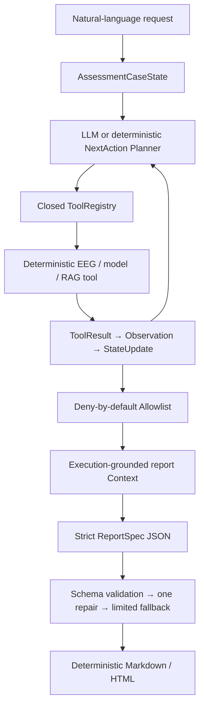

# EEG-ASD Workflow Agent

这是一个面向 EEG 自闭症辅助评估研究的、非临床的工作流智能体。它接收自然语言请求和
`AssessmentCaseState`，根据当前输入及上一轮 Observation 逐轮选择封闭工具，最终只把
白名单字段交给报告 Provider，并从严格 `FinalAssessmentReportSpec` 确定性渲染 Markdown / HTML。

V1 已跑通的主链是：

```text
raw EEG / feature table / existing model result
  → incremental NextAction Planner
  → deterministic EEG tools
  → restricted current-case pretrained baseline
  → execution-grounded RAG query
  → local BM25 knowledge retrieval
  → allowlisted LLM/Offline ReportSpec JSON
  → deterministic Markdown + HTML
```

它不是临床诊断系统，不输出 ASD 确诊、排除诊断、CARS 严重程度或治疗处方。当前合成 EEG、
师兄模型和离线 RAG 的真实性与限制会同时进入 ToolResult、Observation、ReportSpec 和 Trace。

## Agent 接收什么、做什么、输出什么

- 输入：合成 URI、NPZ、MAT、等采样率 EDF，已有特征表，或已有模型结果。
- Agent：读取 Case State 和已完成步骤，每轮返回一个合法 `ActionDecision`，执行后重新规划。
- Tool：只做确定性信号计算、受限模型推理、知识检索、Schema 生成和渲染。
- Allowlist：每个 Manifest 按工作流声明 LLM 可见字段；新字段默认不可见。
- Context：Planner、工具选择和报告生成使用独立、脱敏、执行态 Context。
- 输出：`plan.json`、逐工具结果、Observation、Provider Payload、ReportSpec、Markdown/HTML、Trace 和运行统计。

与固定 Pipeline 的区别是：已有特征会跳过 EEG 链；已有模型结果会跳过推理；质量请求会在
质量 Observation 后停止；质量不通过会阻断模型、RAG 和报告。与旧 Boundary-aware/完整性门控
原型的区别是：边界检查现在是 Manifest、Readiness 和 Context 的组成部分，不再是系统主线。

## V1 执行架构



## 真实工具链

| Tool | V1 行为 | 真实性 |
|---|---|---|
| `inspect_case` | 判断输入资产与跳过条件 | REAL |
| `inspect_eeg` | synthetic / NPZ / MAT / EDF 只读检查 | REAL |
| `check_eeg_quality` | 有限值、平直通道、幅值、时长和通道门控 | REAL |
| `preprocess_eeg` | 1–40 Hz、可用时 50 Hz notch、128 Hz polyphase resample | REAL |
| `extract_events` | 读取事件；缺失时显式标记固定窗推断 | REAL |
| `create_epochs` | 2 秒确定性 epoch | REAL |
| `extract_eeg_features` | Welch PSD、相对频带功率、FAA、theta coherence、Higuchi FD | REAL |
| `check_data_quality` | 已有特征表有限值检查 | REAL |
| `check_model_readiness` | 资产、特征兼容性、插补和已知训练风险门控 | REAL |
| `run_asd_baseline_model` | NumPy 读取师兄已训练 `best_mlp.pt`，执行当前个案前向推理 | RESTRICTED_REAL |
| `research_replay_classifier` | 只保留师兄历史 OOF 行回放；不是当前个案推理 | REPLAY |
| `build_asd_rag_query` | 从已执行模型/特征可用性构造动态查询 | REAL |
| `retrieve_asd_knowledge` | 师兄 KG/论文导出的本地 BM25 检索 | OFFLINE |
| `generate_report_spec` | 真实 Provider 或明确标记的 OfflineProvider | ADAPTER / OFFLINE |
| `render_report` | 不添加事实的 Markdown Renderer；HTML 同步生成 | REAL |

算法只借鉴 `eegsys-bottom-main` 的 polyphase resample、Welch 与 bandpower 思路，不引入其
HDFS、RabbitMQ 或服务进程。paicli 只提供 Registry、预算、停滞检测等设计参考，不调用 Java Runtime、
Shell、MCP 或代码生成工具。

## 已训练基线的事实边界

V1 直接使用师兄 `best_mlp.pt`，不重新训练。该检查点是 7→32→16→3 MLP，目标是三档
`ability_score`，不是 ASD/TD 二分类。Adapter 通过 NumPy 读取 PyTorch zip tensor，模型版本包含
checkpoint SHA-256；因此 Mac 本地无需 PyTorch，也没有使用远程 GPU。

必须保留的限制：

- 原训练脚本是行级随机切分，不是已验证的 subject-level split；
- 原训练 scaler 未保存，V1 使用 `dynamic_features.csv` 重建代理 scaler；
- 原始 EEG 路径产出的同名特征，其语义和量纲尚未证明与训练特征完全一致；
- 缺失模态输入使用参考均值插补，并逐字段报告；
- softmax 仅是不经验证的模型置信值，不是 ASD 概率；
- 不声称泛化性能、临床有效性或诊断能力。

开源模型审计见 `docs/research/16_v1_handoff.md`：EEGPT、EEG-DINO 等公开权重是表征模型，
仍需 ASD 下游训练；公开 autism-detector 使用 8 个临床结构字段而不是 EEG。V1 没有为了“用开源”
把不兼容模型硬接进主链。

## RAG 与 Evidence

`build_asd_rag_query` 只使用请求主题、输入类型、模型模式和“特征名是否可用”，不发送完整特征值。
`retrieve_asd_knowledge` 返回：

```text
evidence_id, title, source, retrieved_chunk, summary,
relevance, metadata, limitations
```

当前 live Neo4j/Spark 入口不可用，运行模式明确为 `offline_bm25_local_export`。ReportSpec 的
`knowledge_interpretation.evidence_ids` 和最终报告都会保留 Evidence ID。

## 快速运行四条 E2E

```bash
cd /Users/nick/programs/eeg-system/eeg-asd-workflow-agent

# 1. 合成 raw EEG → EEG chain → current-case baseline → RAG → report
.venv/bin/python -m eeg_asd_agent.cli run \
  --case demo_cases/01_raw_eeg_full_assessment.json \
  --request "分析这个 EEG，完成 ASD 辅助评估，并检索相关知识生成报告" \
  --offline --output-dir artifacts/v1/raw

# 2. feature table：跳过全部 EEG 工具
.venv/bin/python -m eeg_asd_agent.cli run \
  --case demo_cases/04_feature_table_full_assessment.json \
  --request "根据现有特征完成 ASD 辅助评估并生成报告" \
  --offline --output-dir artifacts/v1/features

# 3. existing model result：跳过模型推理
.venv/bin/python -m eeg_asd_agent.cli run \
  --case demo_cases/core_b_existing_model.json \
  --request "解释已有模型结果，检索相关知识并生成报告" \
  --offline --output-dir artifacts/v1/existing-model

# 4. quality only：质量后停止，不调用模型/RAG/报告
.venv/bin/python -m eeg_asd_agent.cli run \
  --case demo_cases/02_raw_eeg_quality_only.json \
  --request "只检查这个 EEG 的质量，不运行模型，不检索，不生成报告" \
  --offline --output-dir artifacts/v1/quality-only
```

`synthetic://` 由固定 seed 生成信号，只证明链路可执行。真实 NPZ 最小格式为 `data`
（channels × samples）、`sfreq`，可选 `channel_names`、`events`、`unit` 和 `synthetic`。

## LLM Planner 与报告 Provider

离线默认使用确定性 Planner 和 OfflineReportGenerator。要离线验证“每轮 Provider 返回一个
NextAction”的接口，可加 `--planner llm --offline`；这仍是 fixture，不是 LLM 效果。

真实 OpenAI-compatible Responses Provider 只从环境变量读取配置：

```bash
export OPENAI_API_KEY="..."
export OPENAI_MODEL="<pinned-model-id>"
export OPENAI_BASE_URL="https://api.openai.com/v1"  # optional
export OPENAI_TEMPERATURE="0"                       # optional, default 0

.venv/bin/python -m eeg_asd_agent.cli run \
  --case demo_cases/01_raw_eeg_full_assessment.json \
  --request "分析 EEG 并生成辅助评估报告" \
  --no-offline --output-dir artifacts/v1/provider
```

每轮 Provider 收到：脱敏请求、Case State 摘要、白名单 Observation、Capability Manifests、
已完成/失败步骤和当前合法动作；只能返回严格 `ActionDecision`。未知工具、非法参数、提前停止、
Schema 错误或网络故障会回退到 DeterministicPlanner。报告 Provider 只看到 Allowlist Context，
非法 ReportSpec 允许一次 Provider repair，仍失败则生成确定性有限报告。

## 安装、检查与复现

```bash
cd /Users/nick/programs/eeg-system/eeg-asd-workflow-agent
/Users/nick/.cache/codex-runtimes/codex-primary-runtime/dependencies/python -m venv .venv
.venv/bin/python -m pip install -e '.[dev,eeg]'

.venv/bin/python -m eeg_asd_agent.cli tools list
.venv/bin/python -m eeg_asd_agent.cli tools describe run_asd_baseline_model
.venv/bin/python -m eeg_asd_agent.cli profile show

.venv/bin/pytest -q
.venv/bin/ruff check .
.venv/bin/mypy eeg_asd_agent
.venv/bin/python -m compileall -q eeg_asd_agent
```

运行产物中，`llm_payload.json` 是报告 Context；使用 LLM Planner 时另有
`planner_payloads.json`。两者都不包含 raw EEG、完整 feature table、绝对路径、内部模型对象、
密钥或完整 ToolResult。

## 与师兄项目的关系

师兄目录保持只读。V1 只通过受限 Adapter 读取：

- `best_mlp.pt` 与 `dynamic_features.csv`：当前个案受限前向推理；
- `*_with_oof.csv`：仅历史回放；
- KG / paper CSV：本地 BM25 Evidence 检索。

未复制硬编码密钥，未连接旧 Neo4j/Spark 服务，未修改旧工程，未训练或微调新模型。

完整实现交接与失败记录见 [V1 handoff](docs/research/16_v1_handoff.md)。
